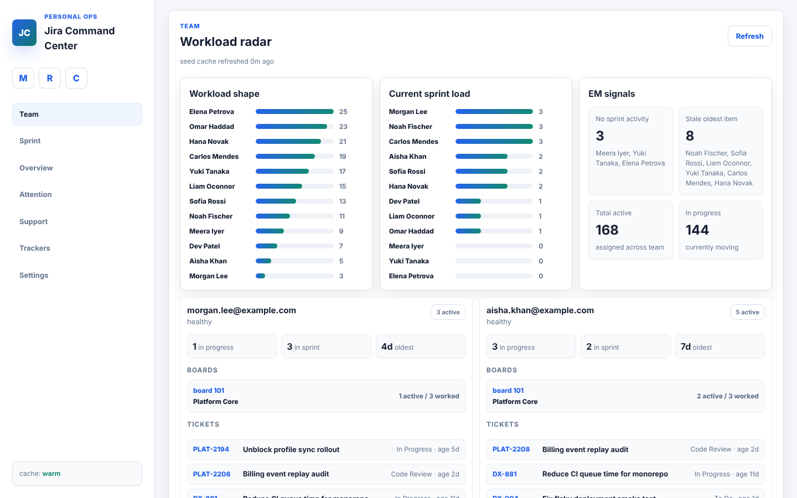
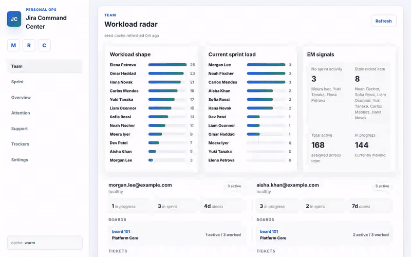
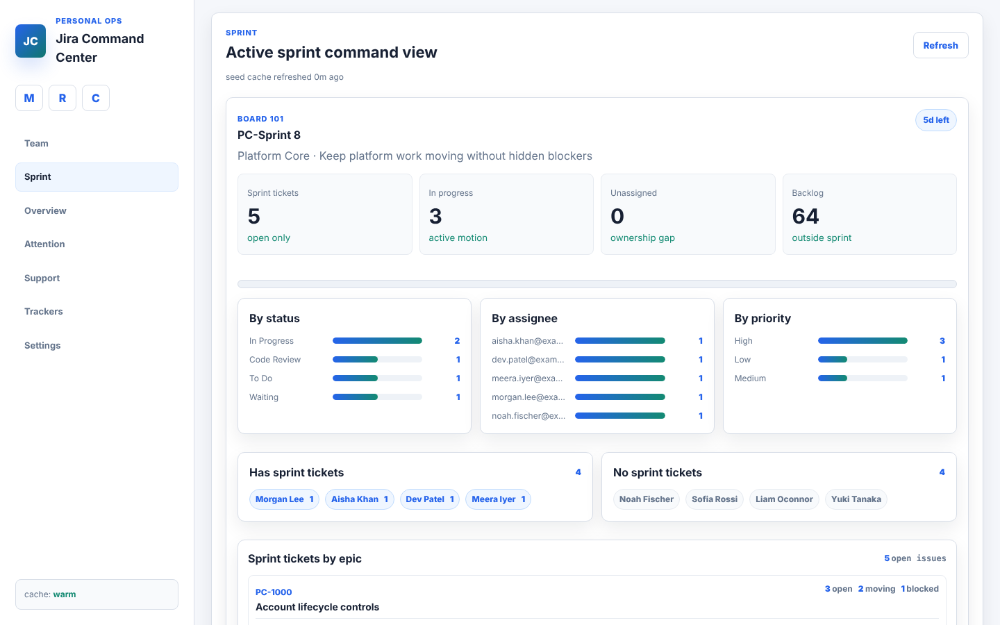
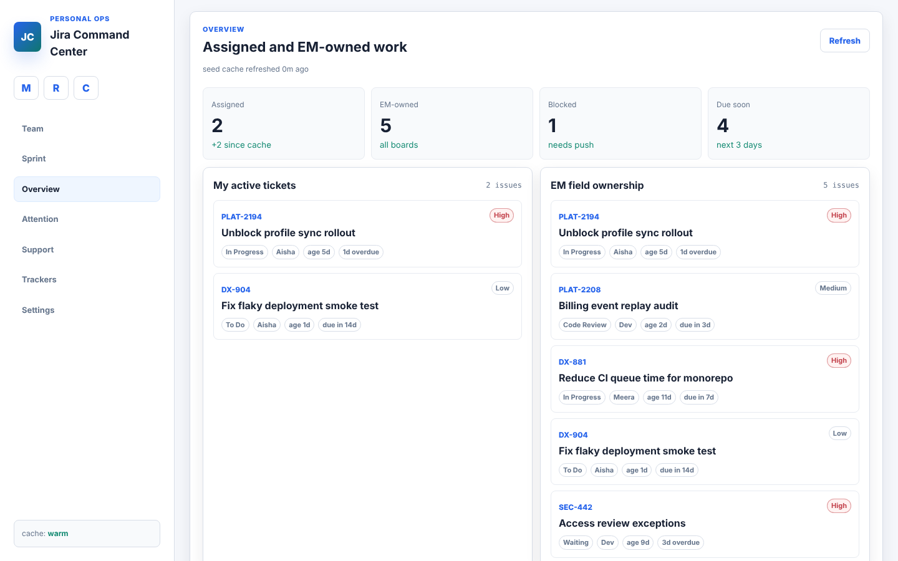
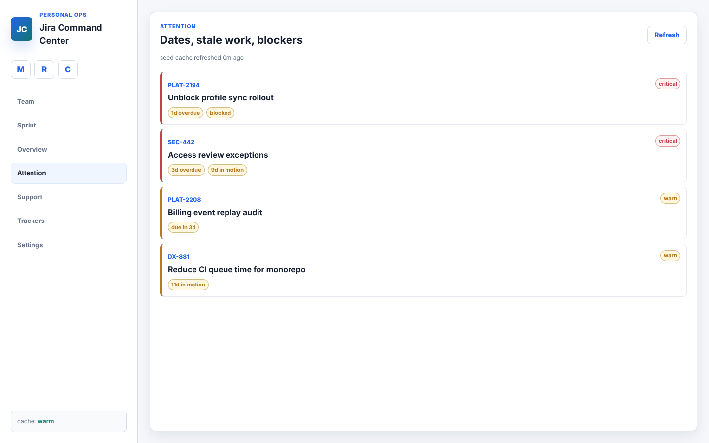
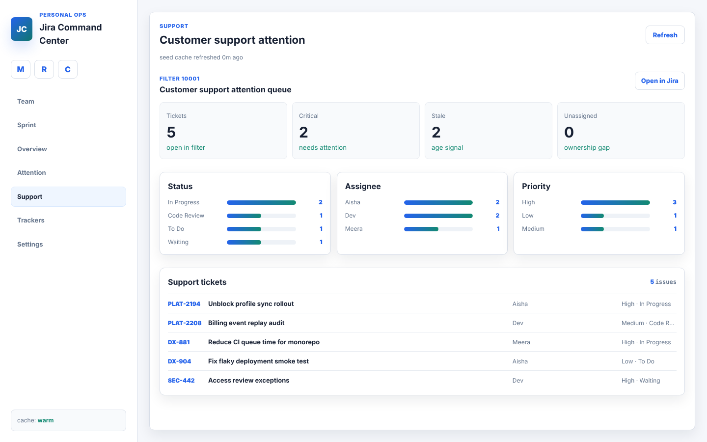
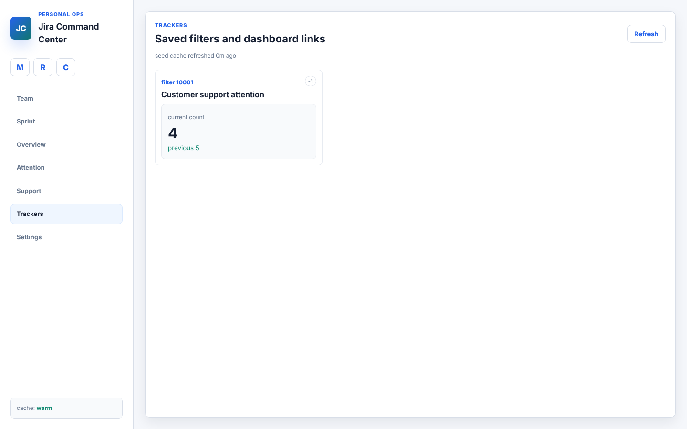
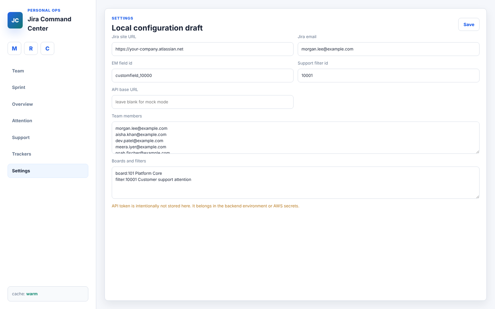
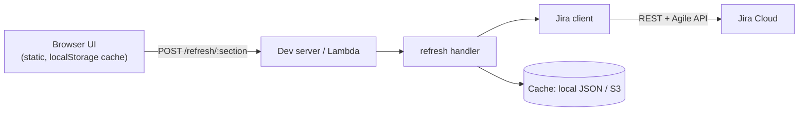

# Jira Command Center

[](LICENSE)


A personal Jira dashboard for engineering managers: see team workload, sprint
health and the tickets that need attention in one place, without clicking
through boards.





## Why I built this

Engineering managers need answers that Jira's boards don't give directly:
Who is overloaded? Who has nothing in the sprint? Which in-progress ticket has
been stuck for two weeks? What in the support queue is about to breach?
Answering that means opening several boards and running ad-hoc filters every
morning.

Jira Command Center puts those questions on one screen. It is cache-first and
refreshes per section on demand, so it stays fast, cheap and well inside
Jira's API limits. Your API token stays on the backend and never reaches the browser.

## Features

- **Team workload radar:** active and in-progress tickets per person, current-sprint load, oldest item age, and flags for stale focus items, capacity risk and people with no sprint activity.
- **Sprint command view:** days remaining, sprint goal, breakdowns by status, assignee and priority, who does and doesn't have sprint tickets, and tickets grouped by epic.
- **Overview:** what is assigned to you and what you own as EM, with blocked and due-soon counts.
- **Attention queue:** overdue, due-soon, blocked and long-in-motion tickets, ranked by severity.
- **Support page:** a saved Jira filter turned into an attention queue with totals, assignee and priority groups, and deep links into Jira JQL.
- **Trackers:** counts for chosen boards, filters and dashboards, compared to the previous refresh.
- **Cache-first UI:** loads from cache and calls Jira only when you press Refresh.
- **Mock mode:** the whole UI runs without credentials, using fictional data.
- Hides done-category tickets everywhere; responsive layout; zero runtime dependencies.

## Screenshots

| | |
| --- | --- |
| <br>Sprint | <br>Overview |
| <br>Attention | <br>Support |
| <br>Trackers | <br>Settings |

Mobile: [`docs/media/mobile-team.png`](docs/media/mobile-team.png)

## Architecture



Details, a refresh sequence diagram and design decisions are in
[docs/ARCHITECTURE.md](docs/ARCHITECTURE.md).

## Tech stack

- Frontend: vanilla JavaScript (ES modules), HTML, CSS. No framework, no build step.
- Backend: Node.js (ESM), Lambda-style handler, Jira Cloud REST v3 and Agile APIs.
- Storage: local JSON files in development; S3 adapter planned for AWS.
- Target hosting: S3 + CloudFront, Lambda, DynamoDB, SSM.

## Quick start

### Mock mode (no credentials)

```bash
git clone https://github.com/ashish979/em-jira-tracker.git
cd em-jira-tracker
npm run serve
```

Open http://localhost:4173.

### Live Jira

```bash
cp .env.example .env     # set JIRA_SITE_URL, JIRA_EMAIL, JIRA_API_TOKEN
npm run discover:fields  # find the "Engineering Manager" custom field id
npm run dev:jira
```

Open http://localhost:4174, add team members and boards/filters in Settings,
then press Refresh. See [docs/jira-setup.md](docs/jira-setup.md) for creating an
API token.

Other commands: `npm run check` (syntax check), `npm run smoke:jira`, `npm run smoke:live`.

## Configuration

| Variable | Description | Default |
| --- | --- | --- |
| `JIRA_SITE_URL` | Jira Cloud site, e.g. `https://your-company.atlassian.net` | required |
| `JIRA_EMAIL` | Account email that owns the API token | required |
| `JIRA_API_TOKEN` | Atlassian API token (server-side only) | required |
| `JIRA_EM_FIELD` | Custom field id holding the Engineering Manager | none |
| `JIRA_SUPPORT_FILTER_ID` | Saved filter id for the Support page | none |
| `CACHE_BACKEND` | `local` or `s3` | `local` |
| `LOCAL_CACHE_DIR` | Directory for local JSON cache | `.cache` |
| `JIRA_CACHE_BUCKET` | S3 bucket for cache (S3 backend) | none |
| `AWS_REGION` | AWS region | `us-east-1` in `.env.example` |
| `PORT` | Dev server port | `4174` |

Team members, boards and filters are configured in the Settings page and stored in the browser.

## Deployment

The intended AWS shape is S3 + CloudFront for `web/`, Lambda for the refresh
handler, S3 for cache blobs and DynamoDB for settings. The S3 cache adapter and
an authenticated Lambda entry point are not implemented yet; see
[docs/aws-architecture.md](docs/aws-architecture.md) and
[docs/ARCHITECTURE.md](docs/ARCHITECTURE.md).

## Project structure

```
web/                      Static UI (index.html, app.js, styles.css)
serverless/
  handlers/refresh.mjs    Per-section Jira payload builders
  jiraClient.mjs          Jira REST / Agile client
  config.mjs              Env loading, cache store selection
  storage/                Local JSON and S3 cache adapters
scripts/                  Dev server, field discovery, smoke tests
docs/                     Architecture, setup guides, media
.claude/skills/           Claude Code skills for this repo
```

## Roadmap

- Implement the S3 cache store and a Lambda entry wrapper with authentication.
- Shared, scheduled refreshes so the UI can read the server-side cache.
- Automated tests with recorded Jira fixtures.
- Trend history for workload and attention counts.
- Jira Data Center / Server support.

## Author

Ashish Agrawal ([@ashish979](https://github.com/ashish979))

Released under the [MIT License](LICENSE).
