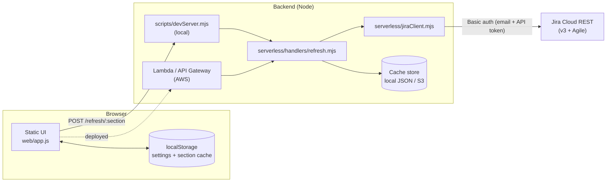
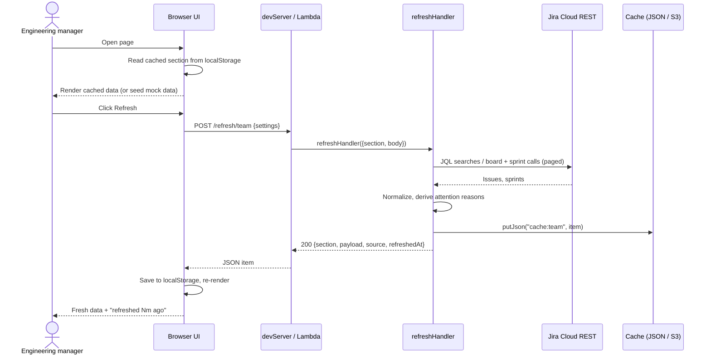

# Architecture

Jira Command Center is a small, cache-first dashboard. A dependency-free static
frontend talks to a thin Node backend that queries Jira Cloud on demand.

## Components

| Component | Path | Role |
| --- | --- | --- |
| UI | `web/` | Six page sections (Team, Sprint, Overview, Attention, Support, Trackers) plus Settings. Renders from cache; has built-in mock data. |
| Dev server | `scripts/devServer.mjs` | Serves `web/` and exposes `POST /refresh/:section` on port 4174. |
| Refresh handler | `serverless/handlers/refresh.mjs` | Builds the payload for one section from Jira and writes it to the cache store. Lambda-shaped (`event` in, `{statusCode, headers, body}` out). |
| Jira client | `serverless/jiraClient.mjs` | Basic-auth REST client: paged JQL search, boards, sprints, backlog, fields. |
| Config | `serverless/config.mjs` | Reads env vars (and a local `.env` when running on `process.env`). |
| Cache store | `serverless/storage/` | `localStore` (JSON files) and an `s3Store` adapter stub. |

## Refresh data flow

## Caching strategy

- Nothing calls Jira on page load. Each section has an independent cache entry
  and an explicit Refresh button, which keeps Jira API usage and cost low.
- Browser: `localStorage` keys `jira-command-center:cache:<section>`, tagged with
  `CACHE_VERSION`. Bumping the constant in `web/app.js` invalidates old caches
  and settings versions.
- Backend: each refresh also writes `cache:<section>` (`section`, `payload`,
  `source`, `refreshedAt`) to the configured store. Today the UI reads only its
  own localStorage copy; the server copy is groundwork for shared or scheduled
  refreshes.
- Without an API base URL the UI generates mock payloads locally.

## Configuration

Server-side (`.env` or Lambda environment), see `.env.example`:

| Variable | Purpose |
| --- | --- |
| `JIRA_SITE_URL`, `JIRA_EMAIL`, `JIRA_API_TOKEN` | Jira Cloud connection. The token never reaches the browser. |
| `JIRA_EM_FIELD` | Custom field id that holds the Engineering Manager. |
| `JIRA_SUPPORT_FILTER_ID` | Saved filter behind the Support page. |
| `CACHE_BACKEND`, `LOCAL_CACHE_DIR`, `JIRA_CACHE_BUCKET`, `AWS_REGION` | Cache store selection. |

Per-user settings (team members, boards/filters, EM field, support filter) live
in the Settings page and are sent with each refresh request as `settings`.

## Deployment

Recommended MVP (see [aws-architecture.md](aws-architecture.md)): S3 + CloudFront
(or Amplify) for `web/`, Lambda function URL or API Gateway HTTP API for
`refreshHandler`, S3 for cache blobs, DynamoDB for settings, SSM Parameter Store
for the token. Set "API base URL" in Settings to the deployed API.

Not yet implemented: the S3 store (`serverless/storage/s3Store.mjs` throws until
`@aws-sdk/client-s3` is added), authentication on the API, and a Lambda entry
wrapper.

## Key design decisions

- **No frameworks, no build step.** Plain ES modules keep it easy to host,
  read and audit.
- **Token stays server-side.** The browser sends only non-secret settings.
- **Explicit refresh over polling.** Predictable cost, no rate-limit surprises.
- **Handler is transport-agnostic.** The same function runs under the local
  dev server and Lambda.
- **Mock mode is a first-class path.** The UI is fully usable without
  credentials, which makes demos and UI work cheap.
- **S3 holds JSON blobs, not a database.** Whole-object cache entries fit S3;
  structured settings belong in DynamoDB.
